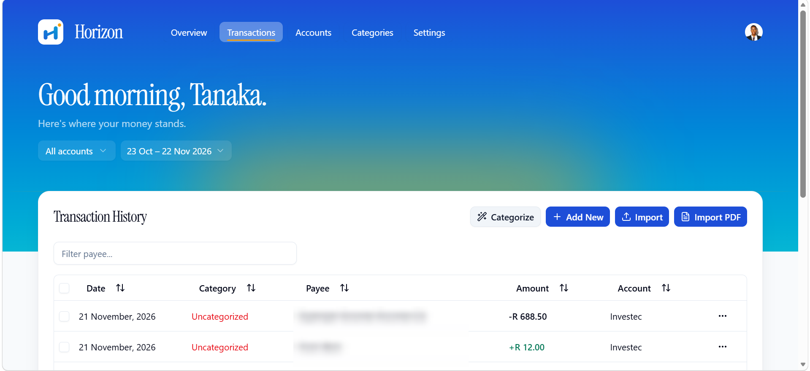
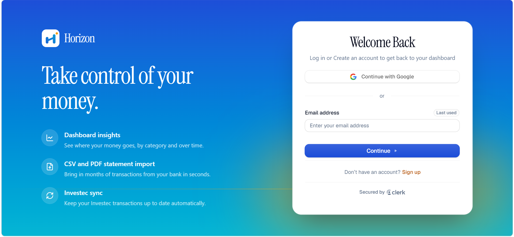
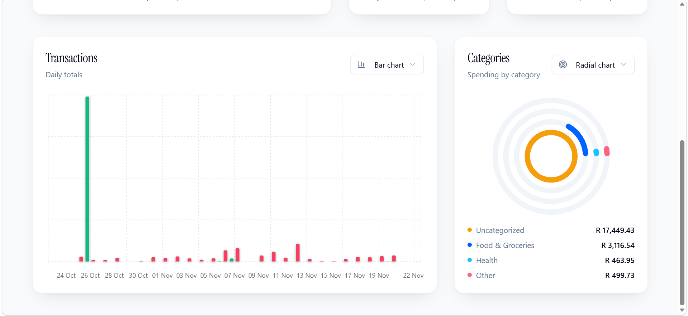
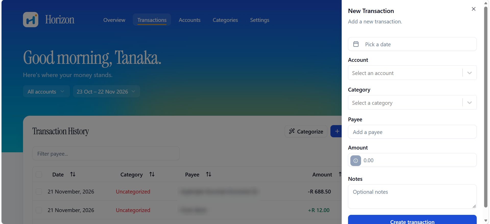
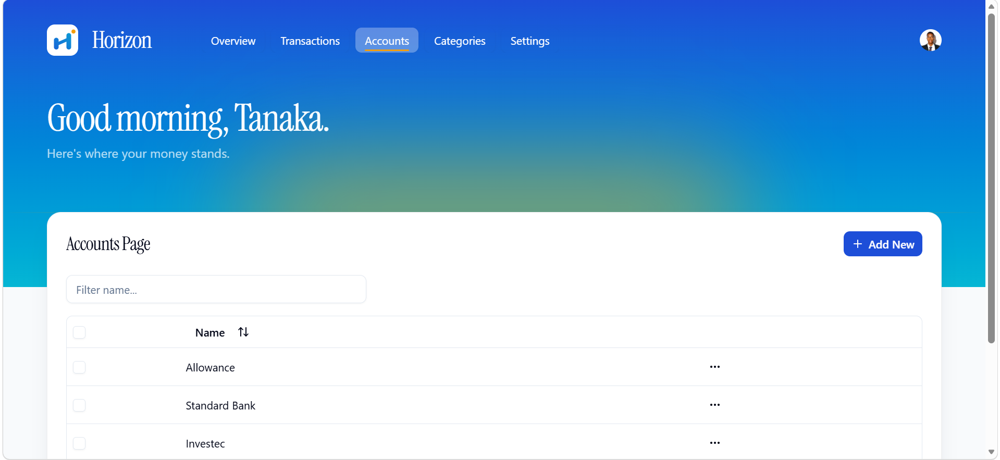

# 💰 Horizon: Personal Finance Tracker

A full-stack personal finance app built for South African banks. Track income and expenses across accounts, import bank statements (CSV or PDF), sync Investec transactions, and see where your money goes on an interactive dashboard.

🔗 **Live demo:** https://finance-tracker-wheat-eight.vercel.app


---

## ✨ Features

- 📊 **Dashboard:** remaining, income and expense cards with period comparisons, switchable area/line/bar charts, and spending by category (pie, radar or radial)
- 🗓️ **Filters:** by account and date range, applied across the whole app
- 💳 **Transactions:** add, edit, search, categorize and bulk delete
- 📄 **Statement import:** CSV with column mapping, and PDF (Standard Bank) parsed in the browser, with duplicate detection
- 🏦 **Investec sync:** connects to Investec Programmable Banking (sandbox) and imports transactions without duplicates
- ⚙️ **Settings:** profile, CSV export of all transactions, bank connections and delete-all-data
- 🔐 **Auth:** branded sign-in and sign-up with email or Google, via Clerk

## 🇿🇦 Why South African banks?

Aggregators like Plaid don't support South African banks, so Horizon brings transactions in through statement imports, which work with any bank, and a direct Investec API integration.

## 📸 Screenshots

| Charts | Transactions |
| --- | --- |
|  |  |

| PDF statement import | Investec connection |
| --- | --- |
|  |  |

| Settings | Sign in |
| --- | --- |
|  |  |

<details>
<summary>More screenshots</summary>

| Chart types | More chart types |
| --- | --- |
|  |  |

| New transaction | Accounts |
| --- | --- |
|  |  |

| Edit account | Categories |
| --- | --- |
|  |  |

</details>

## 🛠️ Tech Stack

Next.js 16 · React · TypeScript · Tailwind CSS v4 · shadcn/ui · Hono · Drizzle ORM · Neon PostgreSQL · Clerk · TanStack Query · TanStack Table · Recharts · pdf.js · Vercel

## 🗺️ Roadmap

- [ ] PDF parsers for FNB, Capitec, Absa and Nedbank
- [ ] Budgets per category
- [ ] Recurring transactions
- [ ] Financial goals
- [ ] Multi-currency support

## ⚙️ Getting Started

**Prerequisites:** Node.js 20.19+, a [Neon](https://neon.tech/) database and a [Clerk](https://clerk.com/) application.

```bash
git clone https://github.com/wantedProgrammer/finance-tracker.git
cd finance-tracker
npm install
```

Create `.env.local` in the project root:

```env
NEXT_PUBLIC_CLERK_PUBLISHABLE_KEY=your_clerk_publishable_key
CLERK_PUBLISHABLE_KEY=your_clerk_publishable_key
CLERK_SECRET_KEY=your_clerk_secret_key
NEXT_PUBLIC_CLERK_SIGN_IN_URL=/sign-in
NEXT_PUBLIC_CLERK_SIGN_UP_URL=/sign-up

DATABASE_URL=your_neon_connection_string
NEXT_PUBLIC_APP_URL=http://localhost:3000

# Investec (server-side only, never prefix with NEXT_PUBLIC_)
INVESTEC_BASE_URL=https://openapisandbox.investec.com
INVESTEC_CLIENT_ID=your_investec_client_id
INVESTEC_CLIENT_SECRET=your_investec_client_secret
INVESTEC_API_KEY=your_investec_api_key
# Comma-separated Clerk user IDs allowed to use the integration. Leave empty to disable it.
INVESTEC_ALLOWED_USER_IDS=
```

Run the migrations and start the dev server:

```bash
npx drizzle-kit migrate
npm run dev
```

Open [http://localhost:3000](http://localhost:3000) and sign in.
