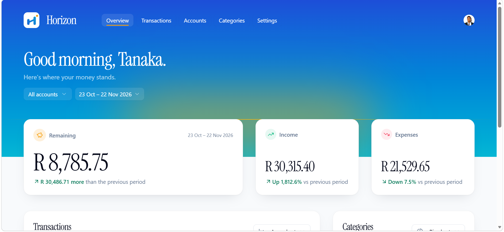
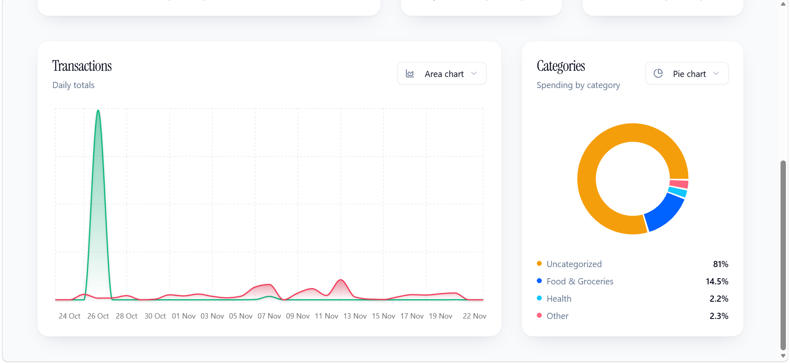
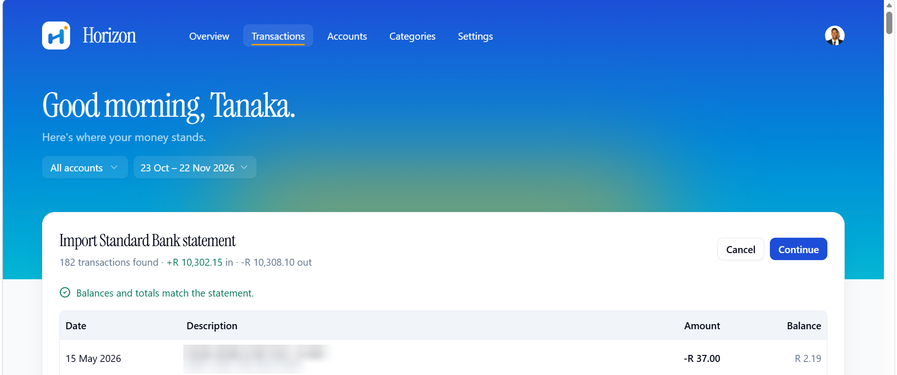
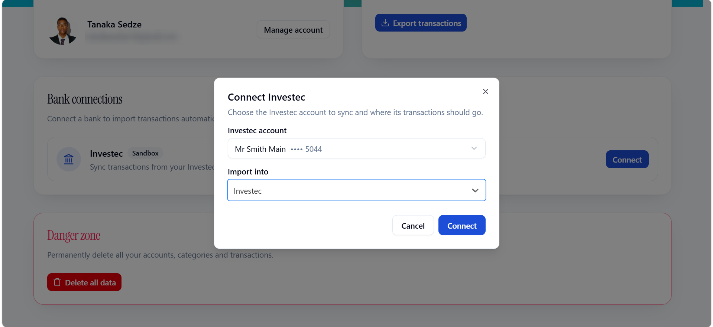
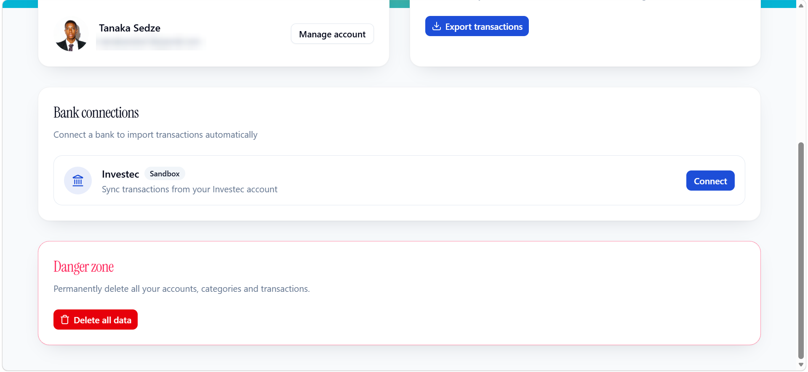
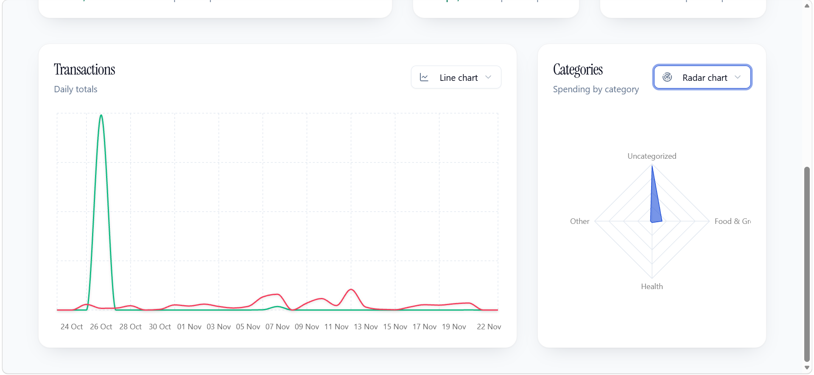
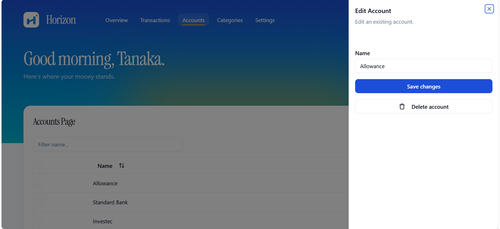
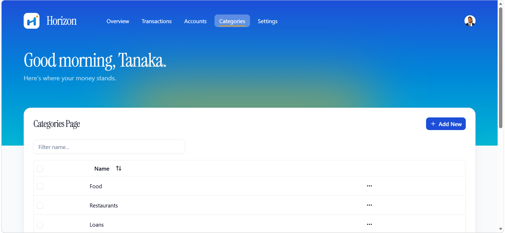

<a name="readme-top"></a>

<!-- PROJECT SHIELDS -->
[](https://github.com/wantedProgrammer/finance-tracker/graphs/contributors)
[](https://github.com/wantedProgrammer/finance-tracker/network/members)
[](https://github.com/wantedProgrammer/finance-tracker/stargazers)
[](https://github.com/wantedProgrammer/finance-tracker/issues)
[](https://github.com/wantedProgrammer/finance-tracker/blob/main/LICENSE)


<!-- PROJECT LOGO -->
<br />
<div align="center">
  <a href="https://github.com/wantedProgrammer/finance-tracker">
    
  </a>

  <h3 align="center">Horizon: Personal Finance Tracker</h3>

  <p align="center">
    A full-stack personal finance app built for South African banks.
    <br />
    <a href="#getting-started"><strong>Get started »</strong></a>
    <br />
    <br />
    <a href="https://finance-tracker-wheat-eight.vercel.app">View Demo</a>
    ·
    <a href="https://github.com/wantedProgrammer/finance-tracker/issues">Report Bug</a>
    ·
    <a href="https://github.com/wantedProgrammer/finance-tracker/issues">Request Feature</a>
  </p>
</div>


<!-- TABLE OF CONTENTS -->
<details>
  <summary>Table of Contents</summary>
  <ol>
    <li>
      <a href="#about-the-project">About The Project</a>
      <ul>
        <li><a href="#features">Features</a></li>
        <li><a href="#why-south-african-banks">Why South African Banks?</a></li>
        <li><a href="#built-with">Built With</a></li>
      </ul>
    </li>
    <li>
      <a href="#getting-started">Getting Started</a>
      <ul>
        <li><a href="#prerequisites">Prerequisites</a></li>
        <li><a href="#installation">Installation</a></li>
      </ul>
    </li>
    <li><a href="#usage">Usage</a></li>
    <li><a href="#roadmap">Roadmap</a></li>
    <li><a href="#contributing">Contributing</a></li>
    <li><a href="#license">License</a></li>
    <li><a href="#contact">Contact</a></li>
    <li><a href="#acknowledgments">Acknowledgments</a></li>
  </ol>
</details>


<!-- ABOUT THE PROJECT -->
## About The Project

[](https://finance-tracker-wheat-eight.vercel.app)

Horizon lets you track income and expenses across accounts, import bank statements (CSV or PDF), sync Investec transactions, and see where your money goes on an interactive dashboard.

### Features

* 📊 **Dashboard:** remaining, income and expense cards with period comparisons, switchable area/line/bar charts, and spending by category (pie, radar or radial)
* 🗓️ **Filters:** by account and date range, applied across the whole app
* 💳 **Transactions:** add, edit, search, categorize and bulk delete
* 📄 **Statement import:** CSV with column mapping, and PDF (Standard Bank) parsed in the browser, with duplicate detection
* 🏦 **Investec sync:** connects to Investec Programmable Banking (sandbox) and imports transactions without duplicates
* ⚙️ **Settings:** profile, CSV export of all transactions, bank connections and delete-all-data
* 🔐 **Auth:** branded sign-in and sign-up with email or Google, via Clerk

### Why South African Banks?

Aggregators like Plaid don't support South African banks, so Horizon brings transactions in through statement imports, which work with any bank, and a direct Investec API integration.

<p align="right">(<a href="#readme-top">back to top</a>)</p>


### Built With

* [](https://nextjs.org/)
* [](https://react.dev/)
* [](https://www.typescriptlang.org/)
* [](https://tailwindcss.com/)
* [](https://ui.shadcn.com/)
* [](https://hono.dev/)
* [](https://orm.drizzle.team/)
* [](https://neon.tech/)
* [](https://clerk.com/)
* [](https://tanstack.com/query)
* [](https://vercel.com/)

Also using TanStack Table, Recharts and pdf.js.

<p align="right">(<a href="#readme-top">back to top</a>)</p>


<!-- GETTING STARTED -->
## Getting Started

To get a local copy up and running, follow these steps.

### Prerequisites

* Node.js 20.19+
* A [Neon](https://neon.tech/) database
* A [Clerk](https://clerk.com/) application
* (Optional) [Investec Programmable Banking](https://developer.investec.com/) sandbox credentials

### Installation

1. Clone the repo
   ```sh
   git clone https://github.com/wantedProgrammer/finance-tracker.git
   cd finance-tracker
   ```
2. Install NPM packages
   ```sh
   npm install
   ```
3. Create `.env.local` in the project root
   ```env
   NEXT_PUBLIC_CLERK_PUBLISHABLE_KEY=your_clerk_publishable_key
   CLERK_PUBLISHABLE_KEY=your_clerk_publishable_key
   CLERK_SECRET_KEY=your_clerk_secret_key
   NEXT_PUBLIC_CLERK_SIGN_IN_URL=/sign-in
   NEXT_PUBLIC_CLERK_SIGN_UP_URL=/sign-up

   DATABASE_URL=your_neon_connection_string
   NEXT_PUBLIC_APP_URL=http://localhost:3000

   # Investec (server-side only, never prefix with NEXT_PUBLIC_)
   INVESTEC_BASE_URL=https://openapisandbox.investec.com
   INVESTEC_CLIENT_ID=your_investec_client_id
   INVESTEC_CLIENT_SECRET=your_investec_client_secret
   INVESTEC_API_KEY=your_investec_api_key
   # Comma-separated Clerk user IDs allowed to use the integration. Leave empty to disable it.
   INVESTEC_ALLOWED_USER_IDS=
   ```
4. Run the database migrations
   ```sh
   npx drizzle-kit migrate
   ```
5. Start the dev server
   ```sh
   npm run dev
   ```
6. Open [http://localhost:3000](http://localhost:3000) and sign in

<p align="right">(<a href="#readme-top">back to top</a>)</p>


<!-- USAGE EXAMPLES -->
## Usage

| Charts | Transactions |
| --- | --- |
|  |  |

| PDF statement import | Investec connection |
| --- | --- |
|  |  |

| Settings | Sign in |
| --- | --- |
|  |  |

<details>
<summary>More screenshots</summary>

| Chart types | More chart types |
| --- | --- |
|  |  |

| New transaction | Accounts |
| --- | --- |
|  |  |

| Edit account | Categories |
| --- | --- |
|  |  |

</details>

_Try it yourself on the [live demo](https://finance-tracker-wheat-eight.vercel.app)._

<p align="right">(<a href="#readme-top">back to top</a>)</p>


<!-- ROADMAP -->
## Roadmap

- [x] CSV statement import with column mapping
- [x] Standard Bank PDF statement parser
- [x] Investec Programmable Banking sync
- [ ] PDF parsers for more banks
    - [ ] FNB
    - [ ] Capitec
    - [ ] Absa
    - [ ] Nedbank
- [ ] Budgets per category
- [ ] Recurring transactions
- [ ] Financial goals
- [ ] Multi-currency support

See the [open issues](https://github.com/wantedProgrammer/finance-tracker/issues) for a full list of proposed features (and known issues).

<p align="right">(<a href="#readme-top">back to top</a>)</p>


<!-- CONTRIBUTING -->
## Contributing

Contributions are welcome, and new bank statement parsers are especially appreciated.

If you have a suggestion that would make this better, please fork the repo and create a pull request. You can also simply open an issue with the tag "enhancement".

1. Fork the Project
2. Create your Feature Branch (`git checkout -b feature/AmazingFeature`)
3. Commit your Changes (`git commit -m 'Add some AmazingFeature'`)
4. Push to the Branch (`git push origin feature/AmazingFeature`)
5. Open a Pull Request

<p align="right">(<a href="#readme-top">back to top</a>)</p>


<!-- LICENSE -->
## License

Distributed under the MIT License. See `LICENSE` for more information.

<p align="right">(<a href="#readme-top">back to top</a>)</p>


<!-- CONTACT -->
## Contact

GitHub: [@wantedProgrammer](https://github.com/wantedProgrammer)

Project Link: [https://github.com/wantedProgrammer/finance-tracker](https://github.com/wantedProgrammer/finance-tracker)

<p align="right">(<a href="#readme-top">back to top</a>)</p>


<!-- ACKNOWLEDGMENTS -->
## Acknowledgments

* [Investec Programmable Banking](https://developer.investec.com/)
* [shadcn/ui](https://ui.shadcn.com/)
* [Recharts](https://recharts.org/)
* [pdf.js](https://mozilla.github.io/pdf.js/)
* [Img Shields](https://shields.io)
* [Best-README-Template](https://github.com/othneildrew/Best-README-Template)

<p align="right">(<a href="#readme-top">back to top</a>)</p>
